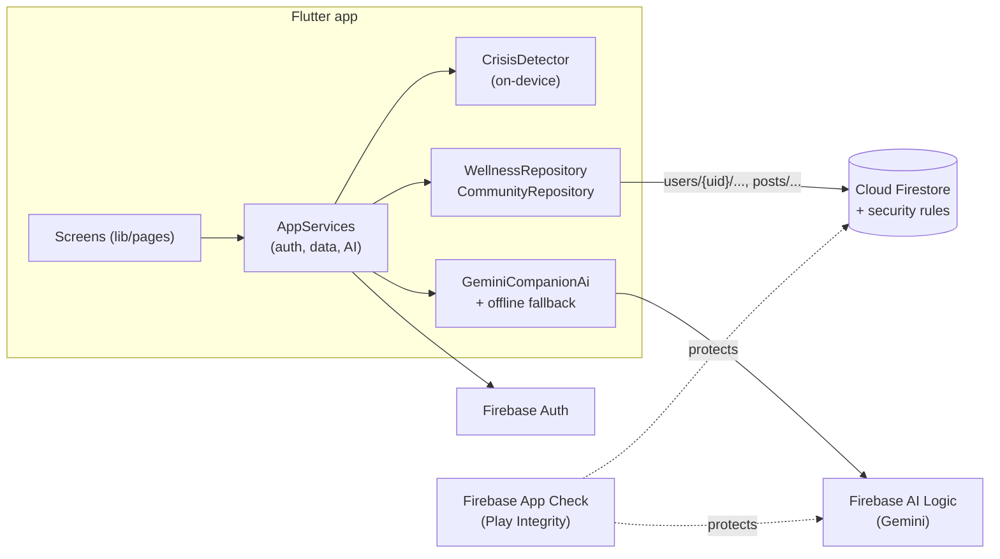

# 🌿 Vibes Nest

**A mental wellness companion app for Sri Lanka, built with Flutter, Firebase and Gemini.**

[](https://github.com/SasmithaTharushan/vibes_nest/actions/workflows/ci.yml)


Vibes Nest brings everyday wellbeing tools into one calm place: guided breathing,
grounding, an AI companion, journaling, sleep and mood tracking, an anonymous
community, and a garden that grows with every act of self-care.

> **Not a medical service.** If you are in crisis, open **Get help now** in the app.
> In Sri Lanka, call **1926** (National Mental Health Helpline) or **1333** (CCCline), both free and 24/7.

<!-- Screenshots: add images to docs/screenshots/ and list them here. -->

## ✨ Features

| | Feature | Highlights |
|---|---|---|
| 💬 | **Talk to Nest** | AI companion (Gemini via Firebase AI Logic) with streaming replies and saved history. Suggests in-app tools. **Crisis messages are caught on-device and never sent to the AI.** |
| 🫁 | **Breath Control** | Animated 4-7-8, Box and Calm breathing with countdown and cycle counter |
| 🧘 | **Stay Calm** | Step-by-step 5-4-3-2-1 grounding for anxious moments |
| 📈 | **Mood tracker** | Dated check-ins, 30-day chart and history |
| 😴 | **Sleep tracker** | Handles past-midnight bedtimes, star ratings, averages, tomorrow's tasks |
| 📝 | **Let It Go** | Private sticky-note journal |
| 👥 | **Community** | Real-time **anonymous** posts, one hug per person, report (auto-hide after 3), crisis check before posting |
| 🌱 | **My Garden** | Points from real self-care; a plant blooms every 10 points; daily streaks |
| 🩺 | **Find professional help** | Verified Sri Lankan helplines and counselling services with call, WhatsApp and web buttons |
| 🆘 | **Get help now** | One tap from Home, chat and community |
| 🔐 | **Accounts** | Email sign-up, password reset, email verification, delete account (removes all data) |

## 🏗️ Architecture



```
lib/
  main.dart                       App start, App Check, AuthGate (Welcome ↔ Home)
  services/
    auth_service.dart             Firebase Auth with friendly error messages
    app_services.dart             Dependency access for screens (and fakes in tests)
    companion_ai.dart             Gemini companion + offline fallback
    crisis_detector.dart          On-device crisis check and tool suggestions
    local_migration.dart          One-time move of old on-device data to the cloud
  data/
    wellness_repository.dart      Private data under users/{uid}/...
    community_repository.dart     Anonymous posts, hugs, reports
    help_directory.dart           Verified helplines (single source of truth)
  models/                         Mood, sleep, journal, chat, garden, posts
  pages/                          UI screens
  widgets/                        Shared widgets
firestore.rules                   Per-user privacy and community fairness rules
tool/generate_icon.dart           Draws the app icon in code
```

### Safety and privacy by design
- **Crisis-first:** every chat message and community post is checked on the device. Crisis messages show helplines immediately and skip the AI.
- **Least access:** Firestore rules allow each user to touch only their own data. Community hug and report counts can only change by ±1 per person.
- **Anonymity:** community posts show a stable nickname derived from the account ID, never a name or email.
- **No keys in the app:** Gemini is called through Firebase AI Logic, protected by App Check.
- **Right to delete:** deleting an account removes every document the user owns, including community posts.
- **Verified contacts:** every helpline number was checked against an official source (see `lib/data/help_directory.dart`).

## 🧪 Tests

```bash
flutter test
```

50+ unit and widget tests using `fake_cloud_firestore`, `firebase_auth_mocks` and a fake AI.
They cover crisis messages never reaching the AI, offline and timeout fallback,
sleep maths across midnight, community hugs and reports, garden streaks, data
migration, account deletion, and the help directory. CI runs them on every push.

## 🚀 Getting started

```bash
git clone https://github.com/SasmithaTharushan/vibes_nest.git
cd vibes_nest
flutter pub get
flutter run
```

The repo is connected to the `vibes-nest` Firebase project. To use your own:

1. Create a Firebase project; enable **Authentication → Email/Password**, **Firestore** and **AI Logic (Gemini Developer API)**.
2. Connect the app and deploy the rules:

   ```bash
   npm install -g firebase-tools
   firebase login
   dart pub global activate flutterfire_cli
   flutterfire configure --project=YOUR_PROJECT_ID --platforms=android
   firebase deploy --only firestore --project YOUR_PROJECT_ID
   ```
3. Debug builds use the App Check **debug provider**: copy the debug token from
   the log into *Firebase console → App Check → Apps → Manage debug tokens*.

## 📦 Releases

Push a tag like `v1.0.0` to build a **signed** APK and App Bundle and publish
them as a GitHub Release. This needs these repository secrets: `ANDROID_KEYSTORE_BASE64`,
`ANDROID_KEYSTORE_PASSWORD`, `ANDROID_KEY_PASSWORD` and `ANDROID_KEY_ALIAS`
(see `android/key.properties.example`).

## 🗺️ Roadmap

- [x] Phase 1: Cleanup, security fixes, no dead-end screens, crisis support
- [x] Phase 2: Firebase accounts and cloud sync
- [x] Phase 3: Gemini AI companion with on-device crisis safety
- [x] Phase 4: Anonymous community, verified help directory, My Garden
- [x] Phase 5: App icon, splash, App Check, CI, release signing, privacy policy
- [ ] Next: Sinhala and Tamil translations, reminders, Play Store listing

## 🔒 Privacy

See [PRIVACY.md](PRIVACY.md).

## 👤 Author

**Sasmitha Tharushan**, Software Engineer × Digital Marketer.
Built as a portfolio project combining full-stack mobile engineering with
safety-focused, user-centred product design.
